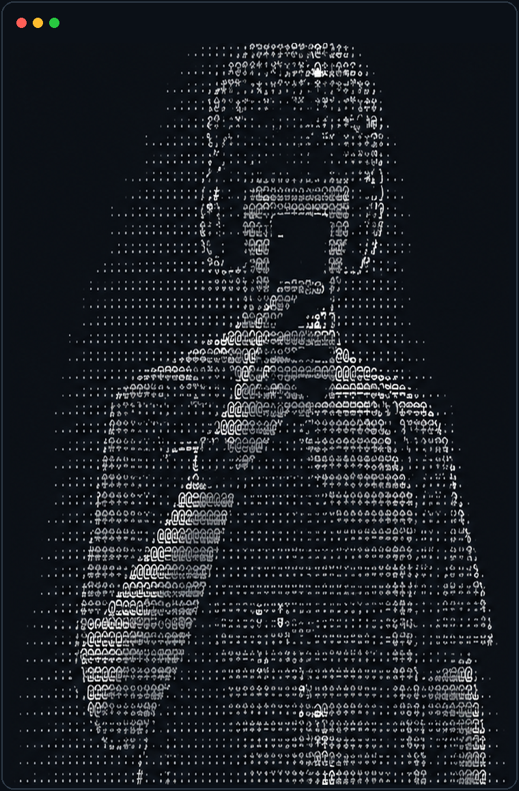

<!-- START: TERMINAL PROFILE (portrait is unchanged; right side is editable HTML text) -->
<table width="100%" align="center">
  <tr>
    <td width="46%" align="center" valign="middle">
      
    </td>
    <td width="54%" align="left" valign="middle">
      <strong><a href="https://github.com/Tinsae-Bahiru"><samp>─ Tinsae-Bahiru@github ─────────────────────────────────</samp></a></strong> 
      <samp>• Name: ........................ Tinsae Bahiru</samp> 
      <samp>• Role: ........................ AI/ML Engineer</samp> 
      <samp>• Development: ................. Full-Stack Developer</samp> 
      <samp>• Location: .................... Addis Ababa, Ethiopia</samp> 
      <!-- PROFILE_LIVE_START -->
      <samp>• GitHub uptime: ............... —</samp> 
      <samp>• Languages: ................... —</samp> 
      <!-- PROFILE_LIVE_END -->
       
      <strong><a href="mailto:tinsaiebbs@gmail.com"><samp>─ Contact ─────────────────────────────────────────────</samp></a></strong> 
      <samp>• Email: ....................... </samp><a href="mailto:tinsaiebbs@gmail.com">tinsaiebbs@gmail.com</a> 
      <samp>• GitHub: ...................... </samp><a href="https://github.com/Tinsae-Bahiru">github.com/Tinsae-Bahiru</a> 
      <samp>• X/Twitter: ................... </samp><a href="https://twitter.com/tinsaie_b">@tinsaie_b</a> 
       
      <strong><a href="https://github.com/Tinsae-Bahiru?tab=repositories"><samp>─ GitHub Stats ───────────────────────────────────────</samp></a></strong> 
      <!-- GITHUB_STATS_START -->
      <samp>• Repos: .......... 16 │ Stars earned: .......... —</samp> 
      <samp>• Forks earned: ... —  │ Followers: ............ 11</samp> 
      <samp>• Following: ..... 10 │ Top repo stars: ........ —</samp> 
      <samp>• Top repo: .......... —</samp> 
       
      <strong><a href="https://github.com/Tinsae-Bahiru?tab=overview"><samp>─ Last 12 Months ─────────────────────────────────────</samp></a></strong> 
      <samp>• Contributions: .. — │ Reviews: ............... —</samp> 
      <samp>• Commits: ........ — │ PRs: ................... —</samp> 
      <samp>• Issues: ......... —</samp> 
      <samp>• Activity: —</samp>
      <!-- GITHUB_STATS_END -->
    </td>
  </tr>
</table>
<!-- END: TERMINAL PROFILE -->

  

💫 About Me

- 💡 I'm Tinsae Bahiru, an AI/Ml Engineer and Full-Stack Developer.
- 🛠️ I'm currently building intelligent systems with Python, FastAPI, Next.js, and Machine Learning.
- 🧠 I work on Computer Vision, NLP, OCR, Fraud Detection, and Cybersecurity ML.
- 🌱 I'm improving my skills in LLMs, RAG, MLOps, and scalable AI systems.
- 💬 Ask me about Python, Machine Learning, Deep Learning, FastAPI, React, and Next.js.
- 📫 Contact me at tinsaiebbs@gmail.com.
- 🤝 I'm open to collaborating on AI, Full-Stack, and Open-Source projects.
- ⚡ Fun fact: I enjoy turning difficult real-world problems into practical software solutions.
 

<picture>
  <source media="(prefers-color-scheme: dark)" srcset="https://raw.githubusercontent.com/Tinsae-Bahiru/Tinsae-Bahiru/output/github-snake-dark.svg" />
  <source media="(prefers-color-scheme: light)" srcset="https://raw.githubusercontent.com/Tinsae-Bahiru/Tinsae-Bahiru/output/github-snake.svg" />
  
</picture>

🌐 Socials

  
  &nbsp;
  
  &nbsp;
  
  &nbsp;
  

💻 Tech Stack

  

  

📈 GitHub Streak

  

<!-- BEGIN: LIVE COLOR TERMINAL (all details remain editable in Markdown) -->
	
	\(\color{#58A6FF}{\texttt{─\ Tinsae-Bahiru@github\ ───────────────}}\) 
 • \(\color{#FFA657}{\texttt{Name:}}\) <samp>·················· Tinsae Bahiru</samp> 
 • \(\color{#FFA657}{\texttt{Role:}}\) <samp>···················· AI/ML Engineer</samp> 
 • \(\color{#FFA657}{\texttt{Development:}}\) <samp>········· Full-Stack Developer</samp> 
 • \(\color{#FFA657}{\texttt{Location:}}\) <samp>··············· Addis Ababa, Ethiopia</samp> 
 • \(\color{#FFA657}{\texttt{GitHub\ age:}}\) <samp>············ <!--LIVE_AGE_START-->—<!--LIVE_AGE_END--></samp> 
 • \(\color{#FFA657}{\texttt{Languages:}}\) <samp>············· <!--LIVE_LANGUAGES_START-->—<!--LIVE_LANGUAGES_END--></samp> 
 
 
 \(\color{#58A6FF}{\texttt{─\ Contact\ ────────────────────────────────}}\) 
 • \(\color{#FFA657}{\texttt{Email:}}\) <samp>······················ <a href="mailto:tinsaiebbs@gmail.com">tinsaiebbs@gmail.com</a></samp> 
 • \(\color{#FFA657}{\texttt{GitHub:}}\) <samp>····················· <a href="https://github.com/Tinsae-Bahiru">github.com/Tinsae-Bahiru</a></samp> 
 • \(\color{#FFA657}{\texttt{Twitter:}}\) <samp>···················· <a href="https://twitter.com/tinsaie_b">@tinsaie_b</a></samp> 
 
 
 \(\color{#58A6FF}{\texttt{─\ GitHub\ Stats\ ───────────────────────}}\) 
 • \(\color{#FFA657}{\texttt{Repos:}}\) <samp>····· <!--LIVE_REPOS_START-->—<!--LIVE_REPOS_END--></samp>   \(\color{#FFA657}{\texttt{Stars:}}\) <samp>····· <!--LIVE_STARS_START-->—<!--LIVE_STARS_END--></samp> 
 • \(\color{#FFA657}{\texttt{Forks:}}\) <samp>····· <!--LIVE_FORKS_START-->—<!--LIVE_FORKS_END--></samp>   \(\color{#FFA657}{\texttt{Followers:}}\) <samp>····· <!--LIVE_FOLLOWERS_START-->—<!--LIVE_FOLLOWERS_END--></samp> 
 • \(\color{#FFA657}{\texttt{Following:}}\) <samp>··· <!--LIVE_FOLLOWING_START-->—<!--LIVE_FOLLOWING_END--></samp>   \(\color{#FFA657}{\texttt{Top\ stars:}}\) <samp>··· <!--LIVE_TOP_STARS_START-->—<!--LIVE_TOP_STARS_END--></samp> 
 • \(\color{#FFA657}{\texttt{Top\ repo:}}\) <samp>·········· <!--LIVE_TOP_REPO_START-->—<!--LIVE_TOP_REPO_END--></samp> 
 
 
 \(\color{#58A6FF}{\texttt{─\ Last\ 12\ Months\ ───────────────────}}\) 
 • \(\color{#FFA657}{\texttt{Contributions:}}\) <samp>··· <!--LIVE_CONTRIBUTIONS_START-->—<!--LIVE_CONTRIBUTIONS_END--></samp>   \(\color{#FFA657}{\texttt{Reviews:}}\) <samp>··· <!--LIVE_REVIEWS_START-->—<!--LIVE_REVIEWS_END--></samp> 
 • \(\color{#FFA657}{\texttt{Commits:}}\) <samp>······ <!--LIVE_COMMITS_START-->—<!--LIVE_COMMITS_END--></samp>   \(\color{#FFA657}{\texttt{PRs:}}\) <samp>····· <!--LIVE_PRS_START-->—<!--LIVE_PRS_END--></samp> 
 • \(\color{#FFA657}{\texttt{Issues:}}\) <samp>······ <!--LIVE_ISSUES_START-->—<!--LIVE_ISSUES_END--></samp> 
 • \(\color{#FFA657}{\texttt{Activity:}}\) <samp><!--LIVE_ACTIVITY_START-->—<!--LIVE_ACTIVITY_END--></samp>

<!-- END: LIVE COLOR TERMINAL -->

  

💫 About Me

- 💡 I'm Tinsae Bahiru, an AI/Ml Engineer and Full-Stack Developer.
- 🛠️ I'm currently building intelligent systems with Python, FastAPI, Next.js, and Machine Learning.
- 🧠 I work on Computer Vision, NLP, OCR, Fraud Detection, and Cybersecurity ML.
- 🌱 I'm improving my skills in LLMs, RAG, MLOps, and scalable AI systems.
- 💬 Ask me about Python, Machine Learning, Deep Learning, FastAPI, React, and Next.js.
- 📫 Contact me at tinsaiebbs@gmail.com.
- 🤝 I'm open to collaborating on AI, Full-Stack, and Open-Source projects.
- ⚡ Fun fact: I enjoy turning difficult real-world problems into practical software solutions.
 

<picture>
  <source media="(prefers-color-scheme: dark)" srcset="https://raw.githubusercontent.com/Tinsae-Bahiru/Tinsae-Bahiru/output/github-snake-dark.svg" />
  <source media="(prefers-color-scheme: light)" srcset="https://raw.githubusercontent.com/Tinsae-Bahiru/Tinsae-Bahiru/output/github-snake.svg" />
  
</picture>

🌐 Socials

  &nbsp;&nbsp;&nbsp;
  &nbsp;&nbsp;&nbsp;
  &nbsp;&nbsp;&nbsp;
  

💻 Tech Stack

  

  

📈 GitHub Streak

  

